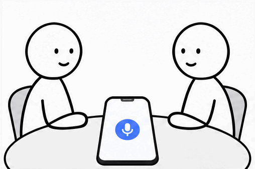
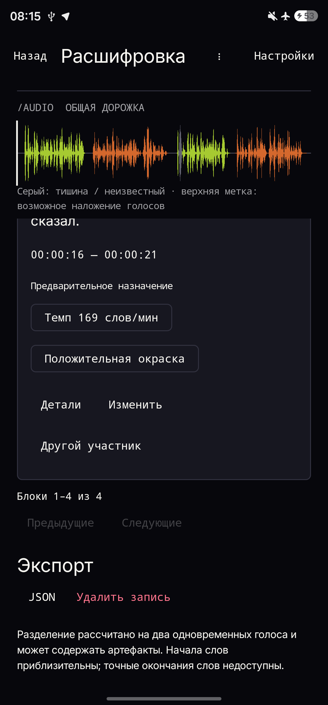
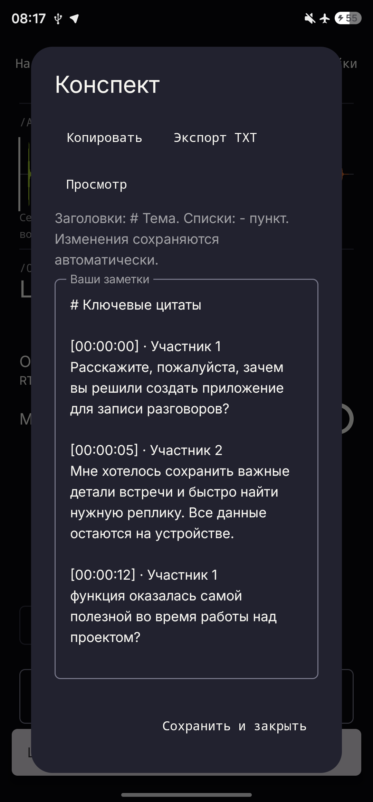
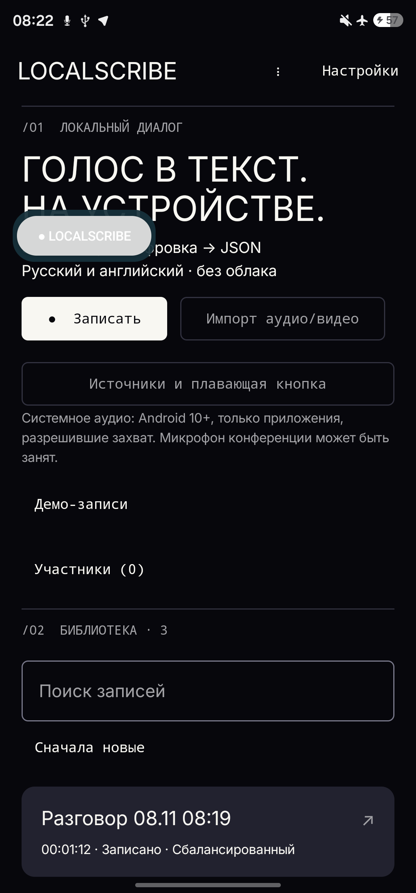

# LocalScribe

Разговор остаётся с вами. LocalScribe превращает аудио в текст прямо на Android: определяет участников, сохраняет временные метки и помогает найти нужную реплику. Без интернета и облачной обработки.

[Скачать APK](https://github.com/zxcd3v/LocalScribe/releases/download/v0.9.3-UX1/LocalScribe.apk) · [Смотреть демонстрацию](docs/VIDEO.md)

## Что умеет

- Записывать микрофон и импортировать аудио или видео.
- Распознавать русскую и английскую речь на устройстве.
- Разделять реплики по участникам и показывать время.
- Воспроизводить запись с подсветкой текста, искать по расшифровке.
- Сохранять конспект и собирать краткий итог из цитат.
- Открывать управление записью через плавающую кнопку поверх других экранов.
- Экспортировать результат в JSON.

## Как проверить за 2 минуты

1. Установите [LocalScribe.apk](https://github.com/zxcd3v/LocalScribe/releases/download/v0.9.3-UX1/LocalScribe.apk) на Android 8+.
2. Отключите Wi-Fi и мобильные данные. При первом запуске дождитесь подготовки встроенных моделей.
3. Импортируйте короткую запись или выберите демо. Нажмите «Обработать запись».
4. Посмотрите текст, участников и таймкоды. Включите воспроизведение, затем сохраните JSON.

Длительность обработки зависит от телефона и записи.

## В действии

[Импорт и офлайн-распознавание](https://github.com/zxcd3v/LocalScribe/releases/download/v0.9.3-UX1/LocalScribe-demo-1.mp4) · [Воспроизведение, JSON и конспект](https://github.com/zxcd3v/LocalScribe/releases/download/v0.9.3-UX1/LocalScribe-demo-2.mp4) · [Плавающая кнопка и запись](https://github.com/zxcd3v/LocalScribe/releases/download/v0.9.3-UX1/LocalScribe-floating.mp4)

  

## Под капотом

Kotlin, Jetpack Compose, ONNX Runtime и sherpa-onnx. GigaAM для русской речи, Whisper Tiny для английской, Nemotron и WeSpeaker для диаризации. Модели и обработка находятся на устройстве.

[Установка и использование](docs/USAGE.md) · [Архитектура](docs/ARCHITECTURE.md) · [Модели и лицензии](docs/MODEL_INVENTORY.md) · [Ограничения](docs/LIMITATIONS.md) · [Проверки](docs/TESTING.md)

Исходники: [src/](src/). Конфигурации: [config/](config/). APK и видео: [Releases](https://github.com/zxcd3v/LocalScribe/releases/tag/v0.9.3-UX1).
