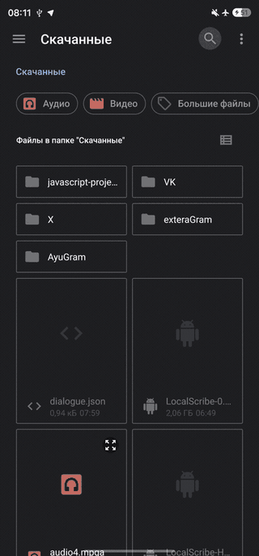
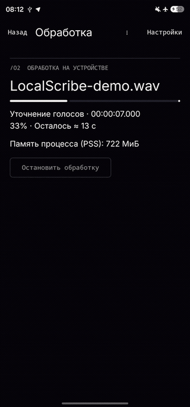
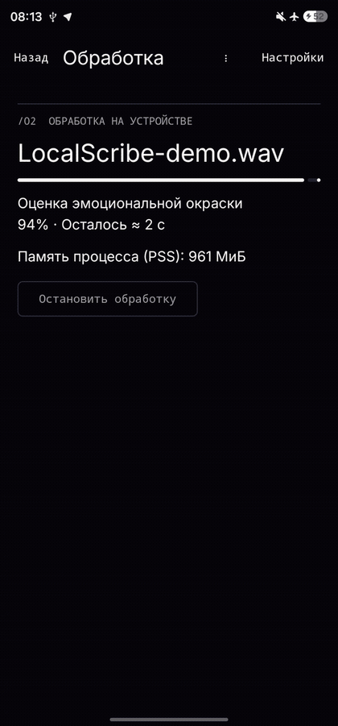
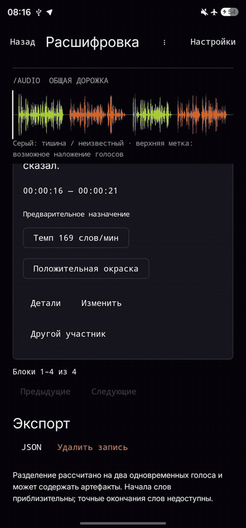
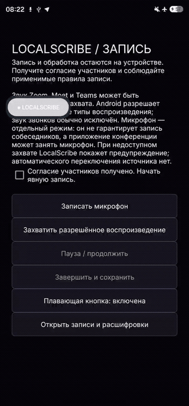

# LocalScribe

LocalScribe превращает разговор в текст прямо на Android: определяет участников, сохраняет временные метки и помогает найти нужную реплику. Записи и обработка остаются на устройстве — без интернета и облака.


**[Скачать LocalScribe](https://github.com/zxcd3v/LocalScribe/releases/download/v0.9.3-UX1/LocalScribe.apk)** · **[Смотреть полную демонстрацию — 4:07](https://github.com/zxcd3v/LocalScribe/releases/download/v0.9.3-UX1/LocalScribe-demo.mp4)**

## Возможности

- Импорт аудио и видео, запись микрофона.
- Русская и английская речь, локальное распознавание.
- Диаризация: реплики разных участников с временными метками.
- Воспроизведение с подсветкой, поиск по расшифровке и переход к аудио.
- Плавающая кнопка для быстрого открытия управления записью.
- Конспект с автосохранением и краткий итог из цитат разговора.
- Экспорт результата в JSON.

## Работа приложения

| Импорт | Распознавание | Участники | Экспорт JSON | Плавающая кнопка |
|:---:|:---:|:---:|:---:|:---:|
|  |  |  |  |  |

## Как проверить за 2 минуты

1. Скачайте **[LocalScribe.apk](https://github.com/zxcd3v/LocalScribe/releases/download/v0.9.3-UX1/LocalScribe.apk)** и установите на Android.
2. Отключите Wi-Fi и мобильные данные. При первом запуске дождитесь локальной подготовки встроенных моделей.
3. Импортируйте короткую запись или выберите демо. Нажмите «Обработать запись».
4. Проверьте текст, участников и время. Запустите воспроизведение и сохраните JSON.

Две минуты — короткий маршрут знакомства. Подготовка моделей и обработка зависят от телефона и длины аудио.

## Установка

Требуется Android 8.0 или новее. Размер APK — около 2 ГБ; оставьте дополнительное место для распаковки моделей и записей. Файл называется **LocalScribe.apk**. Если Android запросит разрешение на установку из выбранного файлового менеджера, предоставьте его и завершите установку.

Модели входят в полную сборку. Скачивать их с телефона не требуется. Приложение можно впервые запустить и использовать без сети.

Сборки с разными подписями нельзя устанавливать друг поверх друга. Перед самостоятельным удалением прежней установки сохраните важные результаты: удаление приложения удаляет его локальные данные.

## Использование

**Импорт.** На главном экране нажмите «Импорт аудио/видео» и выберите WAV, MP3, M4A или MP4 с аудиодорожкой. Откройте запись и нажмите «Обработать запись».

**Микрофон.** Нажмите «Записать», подтвердите согласие участников и разрешите доступ к микрофону. Управление позволяет приостановить, продолжить и завершить запись. После сохранения её можно обработать.

**Плавающая кнопка.** В разделе источников включите переключатель. После предоставления системного разрешения нажмите переключатель ещё раз, если приложение попросит. Нажатие на плавающую кнопку открывает управление записью. Отключается она там же.

**Просмотр.** Откройте обработанную запись. Реплики содержат текст, участника и временной диапазон. Доступны поиск, фильтр участников и воспроизведение с подсветкой.

**Конспект.** «Краткий итог» собирает ключевые цитаты с таймкодами. Их можно добавить в конспект. В конспекте доступны собственные заметки, заголовки, списки и экспорт TXT; изменения сохраняются автоматически.

**JSON.** Прокрутите расшифровку до раздела «Экспорт», нажмите «JSON» и сохраните файл системным диалогом. Результат содержит `transcript` и поля реплик `speaker_id`, `start_ms`, `end_ms`, `text`.

## Архитектура и модели

Интерфейс — Kotlin и Jetpack Compose. Локальное хранилище содержит записи, реплики, участников и заметки. Обработка — ONNX Runtime, sherpa-onnx и нативные JNI-библиотеки на CPU устройства.

Путь данных: локальный файл или микрофон → декодирование аудио → определение речи → STT и диаризация → реплики с временными метками → просмотр и экспорт.

| Задача | Модель | Лицензия по поставленным notices |
|---|---|---|
| Русское распознавание | GigaAM v3 E2E RNN-T | MIT |
| Потоковое распознавание | T-one CTC | Apache-2.0 |
| Английское распознавание | Whisper Tiny | MIT |
| Активность речи | Silero VAD | MIT |
| Диаризация | Nemotron | OpenMDW-1.1 |
| Вектор голоса | WeSpeaker ResNet34 | CC BY 4.0 |
| Сегментация | pyannote 3.0 | MIT |
| Уточнение диаризации | speakrs / VBx | См. лицензии компонентов и весов |
| Разделение голосов | MossFormer2 | Apache-2.0 |
| Эмоциональная окраска | GigaAM-Emo | MIT |

Поставка также содержит необязательный локальный текстовый редактор Qwen3-0.6B под Apache-2.0. Он не выполняет STT и не требуется для получения расшифровки.

Лицензии и атрибуция сохранены в [src/licenses/](src/licenses/) и [src/vendor-sources/](src/vendor-sources/). Манифесты моделей, извлечённые из финального APK, — в [config/final-apk/](config/final-apk/). Конфигурации Gradle-проекта сохранены в [config/](config/). Происхождение отдельных матриц PLDA не установлено в имеющемся комплекте.

## Код финальной версии

Релиз **0.9.3 UX1**, пакет `ru.localscribe`, внутренняя версия `0.9.3-dev`, versionCode `23`. Готовый APK опубликован без изменения содержимого.

- **[src/final-apk/](src/final-apk/)** — непосредственно из финального APK: манифест, ресурсы и smali-код пакета `ru.localscribe` из всех DEX. Этот каталог соответствует опубликованной бинарной поставке.
- **[Полный байткод и бинарные ресурсы](https://github.com/zxcd3v/LocalScribe/releases/download/v0.9.3-UX1/LocalScribe-bytecode.zip)** — все 13 исходных DEX, включая зависимости, бинарные манифест и таблица ресурсов непосредственно из APK. Читаемое smali-представление кода приложения и декодированные ресурсы находятся в `src/final-apk/`. Веса и нативные библиотеки находятся в самом APK.
- **[src/](src/)** также сохраняет имеющийся Gradle-проект с модулями `app`, `core`, `analysis`, `ort`, зависимостями и Java/smali-патчем UX1 в `src/ux1/`.

Smali — восстановленное представление байткода, а не оригинальные Kotlin-исходники. Имеющийся Gradle-проект относится к более ранней версии; он не заменяет исходный проект 0.9.3. Полная воспроизводимая Gradle-сборка финального APK из этих материалов не подтверждена. Для просмотра кода именно выпуска используйте `src/final-apk/` и архив полного байткода.

APK при подготовке материалов не пересобирался и не модифицировался. Ключи подписи и пароли не публикуются.

SHA-256 `LocalScribe.apk`:

```text
bad7914dfc89fdb90897979ae9ec5694427fe8a671e83de8a53dabfaa8298e32
```

## Проверки и демонстрация

Реальная демонстрация записана на **Samsung Galaxy S23 Ultra (SM-S918B)** с установленной версией `0.9.3-dev`. До обработки отключены Wi-Fi и мобильные данные, затем включён авиарежим. Интернет на телефоне после демонстрации не включался.

Импортирована локальная демозапись `interview.wav` длительностью **21 секунда**. Обработка завершилась: **2 участника, 4 блока текста**, временные метки; интерфейс показал **RTF 1,27**. Экспорт всей записи сохранён в `dialogue-offline.json`, **952 байта**. Также показаны воспроизведение, краткий итог, конспект, плавающая кнопка и запуск записи микрофона.

Это демонстрационный сценарий, а не независимый замер точности. В историческом инженерном отчёте предыдущего этапа зафиксированы 69 пройденных core JVM-тестов и 6 тестов утилиты метрик; их нельзя переносить на финальный UX1. При подготовке публикации тесты и сборки не запускались.

**[Полное MP4-видео, 4:07](https://github.com/zxcd3v/LocalScribe/releases/download/v0.9.3-UX1/LocalScribe-demo.mp4)** собрано из настоящих записей экрана. Долгие неподвижные участки сокращены; обработка и результаты не подменялись. Звуковая дорожка отсутствует. Исходные фрагменты сохранены в [Releases](https://github.com/zxcd3v/LocalScribe/releases/tag/v0.9.3-UX1).

## Ограничения

- Модели занимают место и память; скорость зависит от устройства, профиля и длины записи.
- Шум, перебивания и короткие реплики могут ухудшать распознавание и назначение участников. Точность финального UX1 на независимом корпусе не измерена.
- Начала слов приблизительны; точные окончания отдельных слов недоступны.
- Разделение рассчитано на два одновременных голоса и может содержать артефакты.
- Системный звук доступен с Android 10 только для приложений, разрешающих захват. Звук звонков обычно исключён; микрофон может быть занят другим приложением.
- Для финального выпуска доступны извлечённый код и ресурсы; оригинальный Kotlin/Gradle-проект 0.9.3 отсутствует.

## Материалы для проверки

| Материал | Где найти |
|---|---|
| APK | [LocalScribe.apk](https://github.com/zxcd3v/LocalScribe/releases/download/v0.9.3-UX1/LocalScribe.apk) |
| Код выпуска | [src/final-apk/](src/final-apk/), [полный архив](https://github.com/zxcd3v/LocalScribe/releases/download/v0.9.3-UX1/LocalScribe-bytecode.zip) |
| Установка и использование | Разделы этого README |
| Архитектура и модели | Раздел этого README, [конфигурации](config/) |
| Ограничения | Раздел этого README |
| Результаты проверок | Раздел этого README |
| Видеодемонстрация | [MP4, 4:07](https://github.com/zxcd3v/LocalScribe/releases/download/v0.9.3-UX1/LocalScribe-demo.mp4) |
