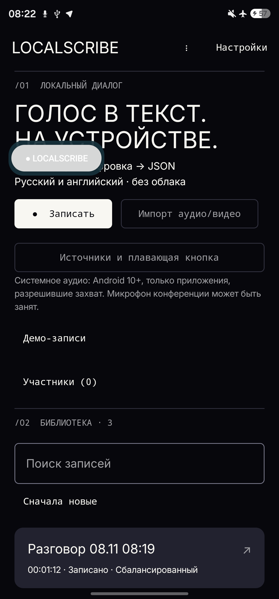

# Видеодемонстрация

Реальная запись экрана Samsung Galaxy S23 Ultra через ADB. Wi-Fi и мобильные данные отключены, авиарежим включён. Обработка выполняется на телефоне. Запись экрана без звуковой дорожки.

1. [Импорт и офлайн-обработка — MP4](https://github.com/zxcd3v/LocalScribe/releases/download/v0.9.3-UX1/LocalScribe-demo-1.mp4): отключение сети, импорт локального WAV, запуск STT и диаризации, получение текста и двух участников.
2. [Работа с результатом — MP4](https://github.com/zxcd3v/LocalScribe/releases/download/v0.9.3-UX1/LocalScribe-demo-2.mp4): воспроизведение, просмотр реплик и временных меток, экспорт JSON, краткий итог, конспект и настройка плавающей кнопки.
3. [Плавающая кнопка и запись — MP4](https://github.com/zxcd3v/LocalScribe/releases/download/v0.9.3-UX1/LocalScribe-floating.mp4): кнопка поверх экрана приложения, открытие управления и запись микрофона.

Фрагменты разделены из-за ограничения Android screenrecord. FFmpeg в окружении отсутствует, поэтому вместо дополнительных GIF опубликованы изображения настоящего интерфейса. [GIF разговора](../assets/conversation.gif) иллюстрирует сценарий; это не запись интерфейса.

